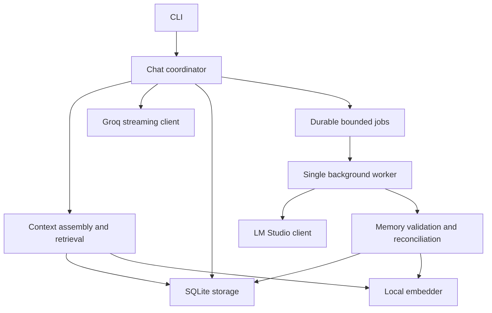

# Goal 1 architecture

Status: proposed technical design supporting the agreed dual-model direction. B01 now implements only `mellow.__main__` and `mellow.config`; all other components below remain proposed.

## Components and dependencies



Groq is hosted. LM Studio defaults to a loopback endpoint; endpoint configuration must make any remote destination explicit. SQLite, job data, and embeddings remain local. Selected retrieved memories leave the machine when included in Groq requests.

The CLI renders and accepts input. The coordinator handles use cases. Provider clients handle HTTP/streaming only. Memory services handle memory policy and retrieval. Storage owns SQL and transactions. Workers consume jobs through these services rather than duplicating business logic.

## Foreground flow

1. Read input and check session/privacy/cancellation state.
2. In persistent mode, save the user message with an identifier.
3. Assemble bounded instructions, recent messages, optional summary, and relevant valid memories.
4. Stream Groq output, rendering safely in the CLI.
5. Persist completion or interrupted/failed status accurately.
6. Enqueue an eligible completed exchange without waiting for local inference. A full queue must not block chat: report deferred work and recover eligible unscheduled exchanges later, with a deduplication key.

Private sessions keep context only in runtime memory and bypass persistent history and jobs. Logs must not retain their payloads.

## Background flow and consistency

One worker thread is the starting design. It manages HTTP requests to the separate LM Studio process; model generation is not Python CPU work in that thread. Benchmark the whole laptop for RAM, GPU, and CPU contention.

Jobs contain source IDs and policy/version metadata rather than unnecessary transcript copies. Resolve still-authorized sources at execution time. Request combined structured facts/episodes where useful, then validate structure, source support, dates, ownership, and conflicts before writing.

Treat job delivery as at-least-once: deduplicate outcomes and make commits idempotent. Use bounded attempts, recoverable leases/status, and an explicit cancellation event. A shutdown deadline may leave a job resumable; do not silently lose it.

Memory is eventually consistent: extraction can finish after the next user message. Recent context supplies immediate continuity. A memory mutation must be committed atomically before retrieval sees it.

Deletion and extraction commits must share an enforced source-validity check. Re-check source existence, suppression state, and session/data generation inside the commit transaction so a late worker cannot restore deleted material. A full reset invalidates in-flight work before clearing owned data.

## Proposed storage model

- Sessions: lifecycle and retention metadata; private sessions are not persisted.
- Messages: role/content, status, source session, timestamps, provider/model usage where available.
- Memories: kind, content, entity/owner, uncertainty/confirmation, recorded time, optional event time, revision/status.
- Memory sources: links between memories and contributing messages.
- Embeddings: memory/version, model revision, dimensions, dtype, vector data.
- Summaries and summary sources: derived text plus dependency links for correction/deletion.
- Jobs: type, source IDs, state, attempt/lease metadata, deduplication key.
- Suppressions: minimal source-linked metadata to prevent unwanted re-extraction; precise representation is pending review.

Use SQLite transactions, schema migrations, foreign-key enforcement, separate connections per worker, and tested busy/locking behavior. WAL is a candidate, not a substitute for transaction design. Store timestamps in UTC and display in the user's configured timezone.

## Retrieval

Start with local embeddings and a simple SQLite-backed similarity scan; no separate vector service is required initially. Apply validity and deletion filters, a measured relevance threshold, deduplication, and a prompt budget. Compare against a keyword baseline. On embedding failure, expose degraded behavior rather than treating zero vectors as valid embeddings.

Stored memories and summaries are contextual data, not trusted system instructions. Personality/policy instructions stay separate. Preserve uncertainty and cite source/date internally for inspection.

## Structure to grow into

```text
Mellow/
  README.md
  docs/
  pyproject.toml           # added during foundation
  .env.example            # names/placeholders only
  .gitignore
  src/mellow/
    cli/                  # terminal interaction/rendering
    chat/                 # orchestration, context, personality
    providers/            # Groq and LM Studio clients
    memory/               # extraction, reconciliation, retrieval
    storage/              # SQLite repositories and migrations
    workers/              # durable jobs and lifecycle
  tests/
```

B01 created `pyproject.toml`, `.gitignore`, `.env.example`, the package initializer, entry point, configuration module, and foundation tests. The local `.venv` and editable-install metadata are generated/ignored. Add code folders/files when their blocks begin. Decide configuration and shared types placement when actual dependencies make it clear. No generic plugin framework or abstract provider hierarchy is required in advance.

## Pending technical selections

Python version, HTTP/SDK choice, CLI library, exact local and Groq models, embedding model/artifact licensing, context budgets, queue capacity, timeout values, default memory review policy, and runtime-data directory. Select through small comparisons and record decisions rather than copying legacy defaults.
