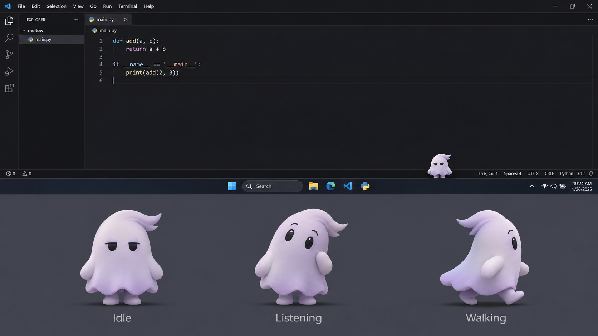

# Mellow avatar reference

These are the original concept images from the design conversation. The desktop and pose sheet governs ordinary scale and silhouette. Scenario images enlarge the character for readability. The final privacy-cloud revision governs bubble styling.

| Reference | Animation and meaning |
|---|---|
| [Privacy pose](02-privacy.png) and [final thought cloud](06-privacy-cloud.png) | Pause screen capture first, then pivot away. A pearl-lilac cloud with two floating dots reads “Giving you privacy”. Fade it while the paused indicator remains. |
| [Shopping](03-shopping.png) | Eyes shift between items, head follows, body leans. Show a brief task cloud only during a real comparison. |
| [Coding](04-coding.png) | Crouch and follow the traceback, then point near the relevant line without covering it. Settle as typing resumes. |
| [Mail](05-mail.png) | Turn toward the owner, raise one hand, offer the reminder in a speech bubble and wait. |

Keep the swept tuft, pear silhouette, oval eyes, small arms, scalloped hem, two feet and soft pearl material with lilac shading. The taskbar is the floor. Eyes lead, head follows, body turns last. Use long idle pauses. Keep bubbles legible on light and dark backgrounds and clear of active controls. Stage changes to shape, motion language or cloud treatment for owner review beside these references. The images specify appearance; a working 3D model and animations still need to be built.

## Current desktop model

[The cloth ghost in eight poses, with thought and speech captions](cloth-poses.png). [The same model climbing](edge-climb.gif). [The hat and folded umbrella study](hat-trick-runtime.png).

## Classic character rig review

[Front, raised hand and rear runtime renders](character-sheet.png) and [desktop-size render](character-desktop.png). The model is defined in Character.cs. Shoulder and wrist pivots, ankle roll, a lagging crown and an animated mouth support the current poses. The hem follows the body as one sculpted shell. Artistic approval is pending.
